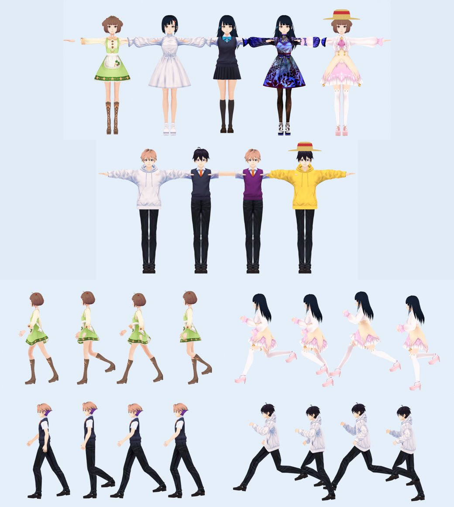

# ตัวละครมนุษย์ 3D สไตล์อนิเมะ (แทนตัวละครทรงเหลี่ยม/Kenney)

Branch `claude/project-thread-jmoj6q` ต่อจาก PR #6 (`claude/phase-11-daily-rewards-d1wobb`) ไม่แตะ `main`



ภาพบนเรนเดอร์จากไฟล์ในเกมจริง (`Resources/Art/Models/avatar/*.bytes`) ด้วย Blender ในเครื่อง cloud ใช้ท่าเดิน/วิ่งจากโค้ด `HumanGait` ชุดเดียวกับที่เกมใช้ **ไม่ใช่ภาพจาก Unity** ภาพในเกมจริงจะใช้ toon shader ของเราเอง และมีผม/กระโปรงพลิ้ว (spring bone) ซึ่งภาพนี้ไม่มี

## ที่มาของโมเดลและไลเซนส์

โมเดลตัวอย่างของ VRoid Studio (pixiv) ไลเซนส์ **CC0** ใช้เชิงพาณิชย์ แก้ไข และแจกจ่ายได้ ไม่ต้องให้เครดิต ทุกไฟล์ต้นทางระบุ `licenseName: CC0` และ `commercialUssageName: Allow` ไว้ในตัวไฟล์ สคริปต์จะปฏิเสธไฟล์ที่ไม่ใช่ CC0 รายละเอียดว่าชิ้นไหนมาจากโมเดลไหนอยู่ใน `apps/game-client/ART_CREDITS.md`

## สิ่งที่ทำ

| ส่วน | ไฟล์ | ทำอะไร |
|---|---|---|
| แปลงโมเดล | `Tools/art/build_avatars.py` | อ่าน .vrm, ย้ายชุด/ผมจากโมเดลต่าง ๆ มาใส่โครงกระดูกเดียวกันต่อเพศ, ตัดผิวที่ถูกเสื้อบัง, ลดโพลีกอนด้วย meshoptimizer, รวม texture เป็น atlas, ทำหมวกฟาง |
| อ่านโมเดล | `Core/Art/GlbModel.cs` | อ่าน skin, joints/weights, morph target (กะพริบตา/ยิ้ม), texture ต่อวัสดุ, extras |
| ท่าทาง | `Core/Art/HumanGait.cs` | ยืน เดิน วิ่ง ผสมตามความเร็ว, เดินตามระยะทางจริงเท้าจึงไม่ไถล, หายใจ เหลียวมอง |
| ตัวละคร | `Unity/Art/AnimeAvatar.cs`, `AvatarParts.cs` | SkinnedMeshRenderer, Humanoid Avatar (สร้างตอนรันจาก bone map ของ VRM) + Animator, เปลี่ยนชุด/ผม/หมวกได้ทันที, หันตัวนุ่มนวล, กะพริบตา, ยิ้มตอนแชต |
| ผม/กระโปรงพลิ้ว | `Unity/Art/SpringBones.cs` | spring bone แบบ VRM 0.x ใช้ค่าจากโมเดลต้นฉบับ มี collider กันทะลุขา ปิดเองเมื่อไกลกล้องเกิน 32 หน่วย |
| Shader | `Resources/Art/Shaders/AnimeToon.shader` | แสงสองโทนแบบอนิเมะ + rim light, ตัดขอบโปร่ง, ย้อมสีผิว มี fallback ถ้า shader ใช้ไม่ได้ |
| เลือกการแต่งตัว | `Core/Art/AvatarLooks.cs` | แปลง item เดิม (outfit/hair/accessory) เป็นชิ้นส่วนโมเดล, สีผิว, รูปร่างหญิง/ชาย |
| หน้าสร้างตัวละคร | `Unity/UI/GameScreens.cs` | เพิ่มปุ่ม "หญิง / ชาย", สีให้เลือกเปลี่ยนเป็น 8 สีผิว |
| Backend | `shared-contracts/schemas.ts` | `avatar.bodyType` = `female` / `male` (ไม่บังคับ) |

ระบบออนไลน์ (`CityState`, `RealtimeClient`, socket) **ไม่ได้แก้** avatar JSON ที่ส่งผ่าน socket มีแค่ field `bodyType` เพิ่มเมื่อผู้เล่นเลือก ผู้เล่นเก่าที่ยังไม่เลือกจะได้รูปร่างคงที่จาก user id (ทุกคนเห็นตรงกัน) ถ้าโหลดโมเดลอนิเมะไม่ได้ เกมจะกลับไปใช้ตัวละคร Kenney/ทรงเรขาคณิตเดิมเอง

ชุดที่มี: หญิง 5 ชุด (ลำลอง, เสื้อขาว, ชุดนักเรียน, ชุดผ้าไหม, ชุดไอดอล) 3 ทรงผม · ชาย 2 ชุดจริง (ฮู้ด, ชุดนักเรียน) และ 2 ชุดที่เป็นการเปลี่ยนสี (ผ้าไหม = เสื้อกั๊กสีม่วง, ไอดอล = ฮู้ดสีทอง) 2 ทรงผม · หมวกฟางทั้งสองเพศ

ขนาด: ประมาณ 14,000-16,000 สามเหลี่ยมต่อตัว, texture รวม 11 MB ใน repo (Unity บีบอัดเป็น ASTC ตอน build)

## คำสั่งที่รันจริงและผล

| คำสั่ง | ผล |
|---|---|
| `python3 Tools/art/build_avatars.py <vrm>` | สร้าง 18 ชิ้นส่วน + 26 texture |
| `dotnet test` (Core, .NET 8) | ผ่าน 113/113 (เพิ่ม 11 ข้อ: ชิ้นส่วนทุกแบบโหลดได้, โครงกระดูกตรงกัน, humanoid map ครบ, ทิศหน้า, ท่าเดิน/วิ่ง/ยืน) |
| type-check โค้ด Unity กับ UnityEngine.Modules 2021.3 (NuGet) | ผ่าน 0 error (ไม่ใช่ Unity 6 จริง) |
| `npm run typecheck`, `npm run lint` | ผ่าน |
| backend unit / e2e | 92/92 · 179/179 (เพิ่มเทสต์ `bodyType`) |
| เรนเดอร์ตรวจใน Blender 5.1 | ชุดทุกแบบ, เดิน, วิ่ง (ภาพด้านบน) |

## ยังไม่ได้ทดสอบ

- **ยังไม่ได้เปิดใน Unity 6 และยังไม่ได้ build APK** ต้องตรวจ: shader คอมไพล์, Humanoid Avatar valid (ดู log `[HappyWorld]`), spring bone, ประสิทธิภาพเมื่อมีผู้เล่นหลายคน
- ลูกค้า NPC ในตลาดเป็นตัวอนิเมะแล้ว (แต่งตามประเภท: นักเรียนใส่ชุดนักเรียน, นักท่องเที่ยวใส่หมวกฟาง, คุณยายใส่ผ้าไหม, สายเทศกาลใส่ชุดไอดอล) จำกัดพร้อมกัน 16 ตัวและปิดผมพลิ้ว ตัวที่เกินยังเป็น Kenney ยังไม่ได้ทดสอบใน Unity
- ผมชายสั้นสีน้ำตาลยังหนัก (7,400 สามเหลี่ยม) ควรลดอีก
- ยังไม่มี LOD: ถ้าเมืองมีผู้เล่น 20+ คนในจอ มือถือรุ่นล่างอาจหน่วง
- ยังไม่มี mocap: ท่าทางทั้งหมดมาจากโค้ด ถ้าภายหลังมีคลิป Humanoid (.fbx) ก็เล่นผ่าน Animator ที่ใส่ไว้แล้วได้

## คำสั่งต่อไป

```bash
./scripts/test-game-client.sh                     # C# Core
cd apps/backend && npm test && npm run test:e2e   # backend
```
Unity: เปิด `apps/game-client` ใน Unity 6 → Play → สร้างตัวละคร เลือก หญิง/ชาย และชุด → เดิน/วิ่งด้วย joystick แล้วดูผมและกระโปรง จากนั้น build APK ตาม `docs/android-build.md`

## Unity 6 + Android Emulator QA (เครื่องผู้ใช้, 20 ต.ค. 2026)

Unity 6000.0.84f1 batch build + `BuildAndroidDev` · Android 14 emulator (SwiftShader OpenGL ES 3.0) · backend จริง

| รายการ | ผล |
|---|---|
| backend lint / typecheck / unit / e2e | ผ่าน · 92/92 · 179/179 |
| Unity compile รอบแรก | ❌ `CS1069 UnityEngine.Avatar` เพราะยังไม่ได้เปิด built-in package Animation → เพิ่ม `com.unity.modules.animation` ใน `Packages/manifest.json` (commit 25319b3) แล้ว build ผ่าน 0 error |
| shader `HappyWorld/AnimeToon` | compile ผ่าน แสดงผลบน GLES3 |
| ตัวละครอนิเมะในเมือง (ผู้เล่นเก่าและใหม่) | ✅ ไม่ตกไปใช้ตัวละครเดิม |
| หน้าสร้างตัวละคร: หญิง/ชาย, สีผิว 8 สี | ✅ เปลี่ยนรูปร่างและสีผิวทันทีหลังบันทึก |
| ซื้อชุดนักเรียน ผมยาวสีดำ หมวกฟาง แล้วใส่ | ✅ ทั้งหญิงและชาย, `avatar` ใน DB มี `bodyType` ถูกต้อง |
| ท่าเดิน / วิ่งด้วย joystick | ✅ ขาก้าวตามความเร็ว แขนแกว่ง |
| exception ใน logcat | 0 |

ข้อสังเกต: ตัวละครเล็กบนจอมือถือ (สูงราว 1/10 ของจอ) รายละเอียดหน้า/ผมพลิ้วดูยาก ควรพิจารณาซูมกล้องเข้าใกล้ขึ้น · NPC ในตลาดยังเป็นแบบเดิม (ตามที่ระบุไว้)

ยังไม่ได้ทดสอบ: มือถือจริง, ผู้เล่นคนอื่นเห็นรูปร่างเดียวกัน (sync), ประสิทธิภาพเมื่อมีผู้เล่นหลายคน, spring bone ดูด้วยตาไม่ชัดในระยะกล้องนี้

